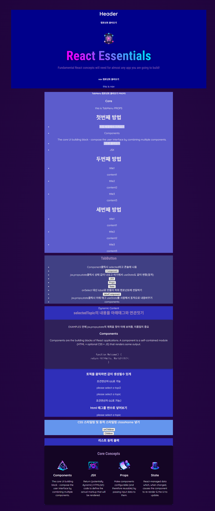
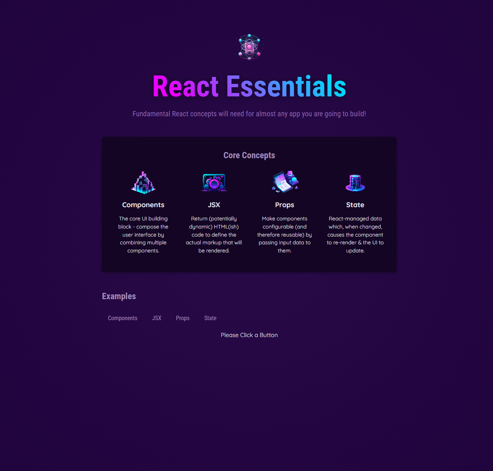
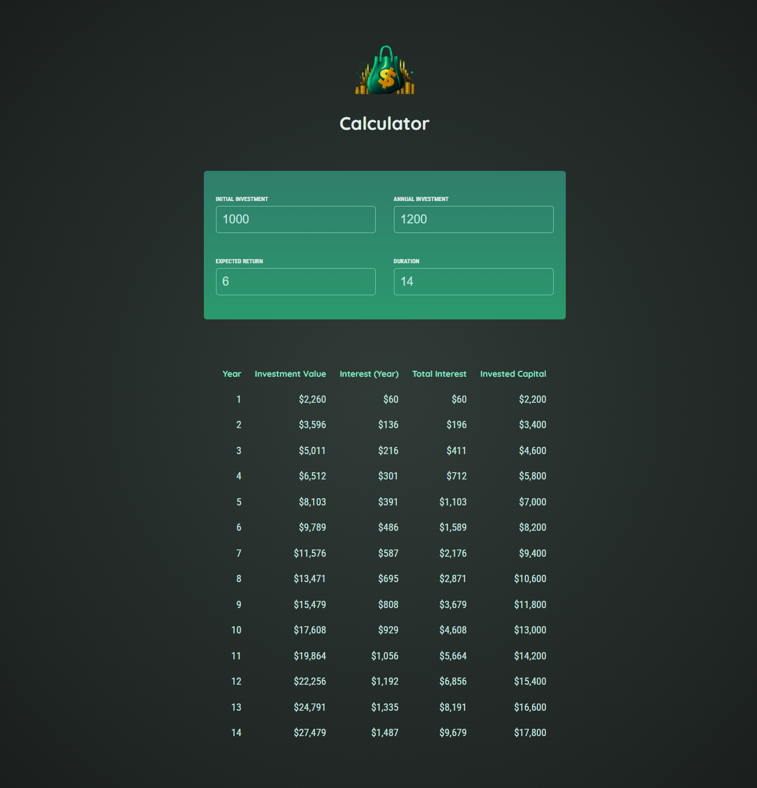
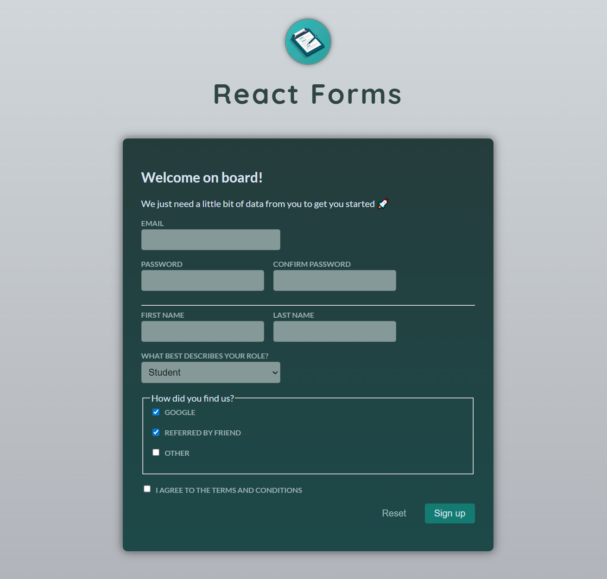
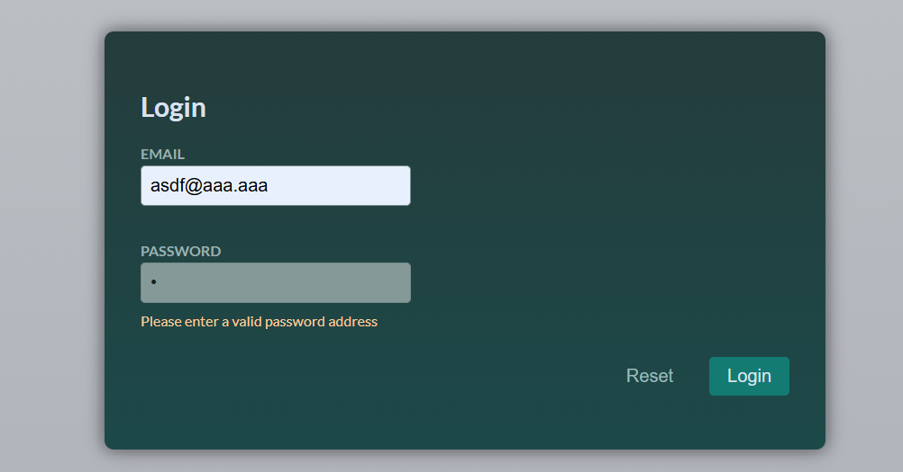

# React 스터디 노트입니다.

### start
main.jsx에서 render 내용 바꾸기
//주석처리를 해야 css가 적용이 안됨

  - App.jsx :: 전체 설명코드(자세한 설명과 코드들이 있다.)
  

  - App2.jsx ::  완성코드
  

  - Calculator.jsx :: 실습해보는 코드 계산기
  

  - FormTwo.jsx :: form 양식 데이터 다루기
  
  useInput.js 로 함수나누고 컴포넌트 공통화 하기
  

  - FormThree.jsx :: form 양식 데이터 다루기

### 단축키
- rfce ::  react function export componemt


### .jsx
.jsx는 브라우저가 직접 이해할 수 있는 형식이 아니며, **개발 도구(빌드 도구)**가 백그라운드에서 JS로 변환해주기 때문에 작동하는 것


### import { useState } from 'react'
리액트에서 컴포넌트의 상태(state)를 관리하기 위한 함수
 "변하는 값"을 저장하고 추적하는 도구

 정적 컴포넌트이면 안써도됨

### 단일 Prop 객체 전달

<CoreConcept
  title={CORE_CONCEPTS[0].title}
  description={CORE_CONCEPTS[0].description}
  image={CORE_CONCEPTS[0].image} />
또는

<CoreConcept
  {...CORE_CONCEPTS[0]} />
대신,

이처럼 CoreConcept 컴포넌트에 하나의 concept Prop를 전달할 수 있습니다 (Prop 이름은 선택적):
<CoreConcept
  concept={CORE_CONCEPTS[0]} />
그러면 CoreConcept 컴포넌트에서는 그 하나의 Prop만 받게 됩니다:

export default function CoreConcept({ concept }) {
  // Use concept.title, concept.description etc.
  // Or destructure the concept object: const { title, description, image } = concept;
}
어떤 문법과 접근 방식을 선호하는지는 전적으로 여러분 선택입니다.

### onChange
- onChange={() => handleChange()}와  onChange={handleChange}의 차이는?

| 코드                                | 설명                                                                           |
| --------------------------------- | ---------------------------------------------------------------------------- |
| `onChange={handleChange}`         | `handleChange` 함수를 **바로 참조**합니다 (함수 자체를 넘김).                                 |
| `onChange={() => handleChange()}` | **화살표 함수로 감싸서** 실행 시점에 `handleChange()`를 **직접 호출**합니다. 매 렌더마다 새로운 함수가 생성됩니다. |


### event.target.value

```
<input
      type="number"
      placeholder="Type something..."
      required
      value={userInput.initialInvestment}
      onChange={(event) => onChange('initialInvestment',event.target.value)}
    />
```
type="number"라도 onChange={(event) => onChange('initialInvestment',event.target.value)}에서는 value가 문자로 출력된다.


#### 실습해보기
```
import React from 'react';
import {useState} from 'react';

// don't change the Component name "App"
export default function App() {
  const [invalidCheck, setInvalidCheck] = useState(false);
        //invalidCheck 는 읽기 전용 setInvalidCheck는 값이 변경할때
    return (
        <div>
            <p className ={invalidCheck ? 'active':undefined}>
            Style me!</p>
            <button onClick={() => setInvalidCheck(!invalidCheck)}>Toggle style</button>
          //() =>가 없으면 무한 랜더링 된다.
        </div>
    );
}

```

### refs, portals

#### 1. Refs (Reference)
React에서 **ref**는 DOM 요소나 컴포넌트 인스턴스에 직접 접근할 수 있는 방법입니다.
일반적으로 React는 상태(state)로 UI를 관리하지만,
가끔 DOM에 직접 접근해야 하는 경우가 있습니다.
```
import React, { useRef } from "react";

export default function App() {
  const inputRef = useRef(null);

  const focusInput = () => {
    // DOM 요소에 직접 접근
    inputRef.current.focus();
  };

  return (
    <div>
      <input ref={inputRef} placeholder="여기에 포커스 가능" />
      <button onClick={focusInput}>포커스 주기</button>
    </div>
  );
}

```

#### Portals

React Portal은 현재 컴포넌트의 DOM 계층 구조 밖에 컴포넌트를 렌더링하는 기능입니다.
ReactDOM.createPortal()을 사용합니다.

```
import React from "react";
import ReactDOM from "react-dom";

function Modal({ children }) {
  return ReactDOM.createPortal(
    <div style={{ position: "fixed", top: 50, left: 50, background: "white", padding: "20px", border: "1px solid black" }}>
      {children}
    </div>,
    document.getElementById("modal-root") // HTML의 별도 div에 렌더링
  );
}

export default function App() {
  return (
    <div>
      <h1>메인 화면</h1>
      <Modal>이건 모달입니다!</Modal>
    </div>
  );
}

```
결과적으로 index.html에는 이런 식으로 추가 div를 만들어둡니다:

```
<div id="root"></div>
<div id="modal-root"></div>

```

차이 요약


| 기능          | 목적                  | 주요 사용 예                     |
| ----------- | ------------------- | --------------------------- |
| **Refs**    | 특정 DOM/컴포넌트 직접 제어   | 포커스, 애니메이션, 외부 라이브러리 DOM 연결 |
| **Portals** | 컴포넌트를 DOM 구조 밖에 렌더링 | 모달, 팝업, 툴팁                  |

### useRef란?
useRef(initialValue)를 호출하면 { current: initialValue } 형태의 객체를 반환해요.

이 객체의 current 속성에 원하는 값을 넣거나 꺼낼 수 있어요.

컴포넌트가 리렌더링되어도 useRef로 만든 객체는 동일한 참조를 유지해요.

useRef는 주로 DOM 요소에 직접 접근하거나, 렌더링에 영향을 주지 않고 어떤 값을 기억해두고 싶을 때 사용해요.

예시
```
import React, { useRef } from 'react';

function TextInputFocus() {
  const inputRef = useRef(null);

  const handleClick = () => {
    // input DOM에 직접 접근해서 포커스 주기
    inputRef.current.focus();
  };

  return (
    <>
      <input ref={inputRef} type="text" />
      <button onClick={handleClick}>포커스 주기</button>
    </>
  );
}

```

### ??  Nullish Coalescing Operator (널 병합 연산자)
```
const name1 = null;
console.log(name1 ?? '익명');
// null → '익명' 출력

const name2 = undefined;
console.log(name2 ?? '익명');
// undefined → '익명' 출력

const name3 = '';
console.log(name3 ?? '익명');
// ''(빈문자열) → 그대로 '' 출력

const name4 = 0;
console.log(name4 ?? 42);
// 0 → 그대로 0 출력
```
### REF와 STATE의 차이점
#### State
값이 변하면 React가 컴포넌트를 다시 실행(render) 함.

즉, setState() → 함수 전체 재실행.

변경된 값은 다음 렌더에서 적용됨.

```
function Counter() {
  const [count, setCount] = React.useState(0);

  console.log('렌더링!');

  return (
    <>
      <p>{count}</p>
      <button onClick={() => setCount(count + 1)}>+1</button>
    </>
  );
}

```
버튼 클릭 시:

setCount(count + 1) 실행

React가 컴포넌트를 다시 호출

count의 새로운 값으로 화면 갱신

#### Ref

값이 변해도 함수 재실행 없음.

그냥 변수에 값 저장하는 것과 같음.

변경 즉시 반영되지만 화면에는 영향 없음.
```
function RefExample() {
  const countRef = React.useRef(0);

  console.log('렌더링!');

  return (
    <>
      <p>{countRef.current}</p>
      <button onClick={() => { countRef.current += 1; console.log(countRef.current); }}>+1</button>
    </>
  );
}

```
버튼 클릭 시:

countRef.current 값만 바뀜

렌더링 안 됨 (화면 숫자 그대로)

콘솔에는 값이 증가된 것 출력


| 단계       | State 변경           | Ref 변경             |
| -------- | ------------------ | ------------------ |
| 값 변경 시   | React가 컴포넌트를 다시 실행 | 값만 바뀜, 컴포넌트 재실행 없음 |
| 화면 반영 시점 | 다음 렌더링 때           | 직접 렌더링 트리거 해야 반영됨  |
| 내부 로직 영향 | 다음 렌더에 새로운 값 적용    | 즉시 새로운 값 사용 가능     |


### dialog

이건 HTML5에서 추가된 네이티브 대화상자(Modal) 컴포넌트입니다.

1. 기본 개념
dialog는 HTML에서 팝업/모달 창을 만들 때 쓰는 태그.

CSS나 JS 없이도 기본적인 팝업 동작을 제공.

open 속성이 있어야 화면에 표시됨.

JS의 .show() 또는 .showModal() 메서드로 열 수 있음.

```
<dialog id="myDialog" open> <!--여기에 open 써도됨 -->
  <p>안녕하세요, 대화상자입니다!</p>
  <button id="closeBtn">닫기</button>
</dialog>

<button id="openBtn">열기</button>

<script>
  const dialog = document.getElementById('myDialog');
  const openBtn = document.getElementById('openBtn');
  const closeBtn = document.getElementById('closeBtn');

  openBtn.addEventListener('click', () => {
    dialog.showModal(); // 모달 형태로 열기
  });

  closeBtn.addEventListener('click', () => {
    dialog.close(); // 닫기
  });
</script>

```

| 메서드            | 설명                           |
| -------------- | ---------------------------- |
| `.show()`      | 대화상자를 **비모달**로 열기 (뒤 클릭 가능)  |
| `.showModal()` | **모달**로 열기 (뒤 클릭 불가, 포커스 고정) |
| `.close()`     | 대화상자 닫기                      |


 React에서 쓸 때 주의점

dialog는 DOM API를 직접 호출해야 열림/닫힘이 가능하므로
React에서 useRef를 이용해서 showModal()이나 close()를 호출해야 함.

예:
```
const dialogRef = useRef(null);
dialogRef.current.showModal();
dialogRef.current.close();
```

## 리액트에서 forwardRef와 useImperativeHandle 에 대해

1. forwardRef
기본적으로 부모가 자식 컴포넌트의 DOM에 바로 접근할 수 없습니다.

forwardRef는 부모에서 전달한 ref를 자식 컴포넌트 내부의 DOM이나 다른 ref로 "전달(forward)"해 주는 기능입니다.

예시
```

import React, { forwardRef } from "react";

const MyInput = forwardRef((props, ref) => {
  return <input ref={ref} {...props} />;
});


---
function App() {
  const inputRef = React.useRef();

  return (
    <>
      <MyInput ref={inputRef} />
      <button onClick={() => inputRef.current.focus()}>포커스</button>
    </>
  );
}
```
📌 이렇게 하면 부모에서 inputRef.current.focus()로 자식의 <input> DOM에 접근 가능.

2. useImperativeHandle
forwardRef로 전달된 ref의 동작을 커스터마이징할 때 사용합니다.

DOM 전체를 노출하는 대신, 특정 메서드만 노출할 수 있습니다.

예시

```
import React, { forwardRef, useImperativeHandle, useRef } from "react";

const MyInput = forwardRef((props, ref) => {
  const inputRef = useRef();

  useImperativeHandle(ref, () => ({
    focus: () => {
      inputRef.current.focus();
    },
    clear: () => {
      inputRef.current.value = "";
    }
  }));

  return <input ref={inputRef} {...props} />;
});


---

function App() {
  const myInputRef = React.useRef();

  return (
    <>
      <MyInput ref={myInputRef} />
      <button onClick={() => myInputRef.current.focus()}>포커스</button>
      <button onClick={() => myInputRef.current.clear()}>지우기</button>
    </>
  );
}
```
📌 이 경우 부모는 myInputRef.current.focus()나 myInputRef.current.clear()만 사용할 수 있고, DOM 전체가 노출되지 않습니다.

정리
| 훅/함수                  | 역할                           |
| --------------------- | ---------------------------- |
| `forwardRef`          | 부모가 자식 컴포넌트에 ref를 전달할 수 있게 함 |
| `useImperativeHandle` | 전달된 ref의 기능(노출 메서드)을 제한/정의   |

* useImperativeHandle은 원래 forwardRef로 전달된 ref를 커스터마이징하기 위한 훅이라서, forwardRef 없이 단독으로는 쓸 수 없습니다.


```
import React, { useState, useRef, useEffect, use } from 'react';
import ResultModal from "./ResultModal.jsx";
function TimerChallenge({title,targetTime}) {
  const [timerStarted, setTimerStarted] = useState(false);
  const [timerExpired, setTimerExpired] = useState(false);
  const timer =useRef(null);
  const dialog = useRef();

  function handleStart() {
   timer= setTimeout (() => {
      setTimerExpired(true);
      dialog.current.open();
    }, targetTime * 1000);
    setTimerStarted(true);
  }

  function handleStop() {
    clearTimeout(timer.current);
  }
  return (
    <>
      {timerExpired && <ResultModal ref = {dialog} targetTime={targetTime} result = "lost"/>}
      <section className="challenge">
        <h2>{title}</h2>
        {timerExpired  && <p>you lost</p>}
        <p className="challenge-time">
          {targetTime} second{targetTime >1 ? 's' : ''}
        </p>
        <p>
          <button onClick={timerStarted ? handleStop : handleStart}>
            {timerStarted ? 'Stop':'Start'} Challenge
          </button>
        </p>
        <p className={timerStarted ? 'active' : undefined}>
          {timerStarted ? 'Time is runnuing...':'Timer inactive'}
        </p>
      </section>
    </>
  );
}

export default TimerChallenge;

```
여기 위에서open이아래의open 함수임

```
import { useImperativeHandle,forwardRef } from "react"

const ResultModal=forwardRef({ result, targetTime },ref) {
  const dialog = useRef();

  useImperativeHandle(ref,()=>{
    return {
      open(){
        dialog.current,showModal();
      }
    }
  });

  return (
    <dialog ref={ref} className= "result-modal" > //open
      <h2> you {result}</h2>
      <p>The target Time was <strong>{targetTime} seconds.</strong> </p>
      <p>You stopped the timer with <strong>X seconds left</strong></p>
      <form method ="dialog">
        <button>close</button>
      </form>
    </dialog>
  )

  export default ResultModal ;
}

```

### setTimeout과 setInterval 차이

둘 다 JavaScript에서 비동기 타이머를 설정하는 함수인데, 동작 방식이 달라요.

#### 1. setTimeout(fn, delay)
한 번만 실행

delay(ms) 후에 fn 함수를 1회 호출하고 끝

예: “3초 뒤에 알람 띄우기”

```
setTimeout(() => {
  console.log("3초 지남");
}, 3000);

```
→ 3초 뒤에 한 번만 실행

#### 2. setInterval(fn, delay)
계속 반복해서 실행

delay(ms)마다 fn 함수를 계속 호출

예: “1초마다 현재 시각 출력”

```
setInterval(() => {
  console.log(new Date());
}, 1000);

```
→ 1초마다 계속 실행

- 차이

| 구분    | setTimeout              | setInterval              |
| ----- | ----------------------- | ------------------------ |
| 실행 횟수 | 1회                      | 무한 반복 (멈출 때까지)           |
| 멈추는 법 | `clearTimeout(timerId)` | `clearInterval(timerId)` |
| 용도    | 특정 시간 뒤 한 번만 실행         | 일정 주기로 계속 실행             |

- 주의할 점

setInterval은 내부 실행이 끝나기 전에 다음 호출이 시작될 수도 있음 → 긴 작업이면 밀릴 수 있음

일정 주기 실행이 필요하지만 정확한 간격 유지가 중요하다면 setTimeout을 재귀적으로 사용하는 방법이 더 안전함

- 정리

  딱 한 번 실행 → setTimeout

  반복 실행 → setInterval

### createPortal

 React에서 컴포넌트를 현재 DOM 계층 구조 밖의 다른 DOM 노드에 렌더링할 수 있게 해주는 기능4
 보통 모달, 툴팁, 드롭다운 같은 UI를 만들 때,
컴포넌트를 부모 컴포넌트 내부가 아닌, 보통 body 직속이나 별도의 레이어에 붙여야 할 때가 있어요.
createPortal을 쓰면 React 컴포넌트 구조는 유지하면서도, 렌더링 위치만 따로 지정할 수 있어요.
```
import { createPortal } from 'react-dom';


  return createPortal(
    <dialog ref={dialog} className= "result-modal" > //open
      {userLost && <h2>You lost</h2>}
      {!userLost && <h2>Your Score: {score}</h2>}
      <p>The target Time was <strong>{targetTime} seconds.</strong> </p>
      <p>You stopped the timer with {' '}<strong>{formattedRemainingTime}  seconds left</strong></p>
      <form method ="dialog" onSubmit={onReset}>
        <button>close</button>
      </form>
    </dialog>,
    document.getElementById('modal')
  );
});


index.html 에
<div id="modal"></div>를 붙여야한다.

```

| 구분                | `createPortal` 없이 | `createPortal` 사용 시      |
| ----------------- | ----------------- | ------------------------ |
| 렌더링 위치            | 부모 컴포넌트 내부 DOM    | 부모 DOM 밖, 지정한 별도 노드에 렌더링 |
| 스타일 충돌 가능성        | 높음                | 낮음                       |
| z-index, 스크롤 등 이슈 | 발생할 수 있음          | 최소화                      |


### 모달을 ESC(Escape) 키로 닫기
dialog 요소를 사용하면 웹사이트 방문자가 키보드의 ESC(Escape) 키를 눌러 열린 대화창을 닫을 수 있습니다.

현재, 이것은 버튼 클릭으로 대화상자를 닫는 것과 달리, onReset함수를 트리거하지 않습니다.

ESC 키로 대화창을 닫을 때 onReset이 트리거되도록 하려면 dialog 요소에 내장된 onClose 속성을 추가하고 그 값을 onReset속성에 바인딩해야 합니다.


다음과 같습니다:

```
<dialog ref={dialog} className="result-modal"

onClose={onReset}
   ...
</dialog>
```

## FORM 처리 방식

### useRef와 useState의 차이

https://github.com/firsthandcraft/React_Prac/wiki/from-%EC%96%91%EC%8B%9D-%EC%A0%9C%EC%9E%91#reset

### reset

https://github.com/firsthandcraft/React_Prac/wiki/from-%EC%96%91%EC%8B%9D-%EC%A0%9C%EC%9E%91#reset


### TypeScript설치

npx create-react-app my-app --template typescript


